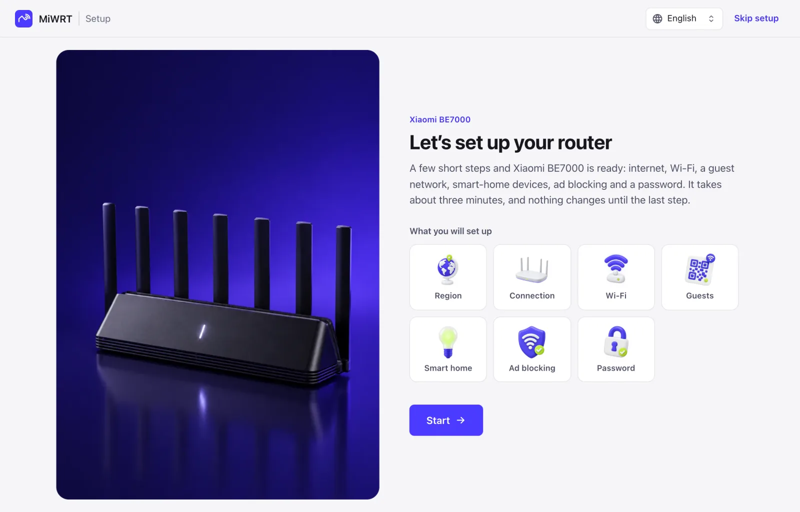
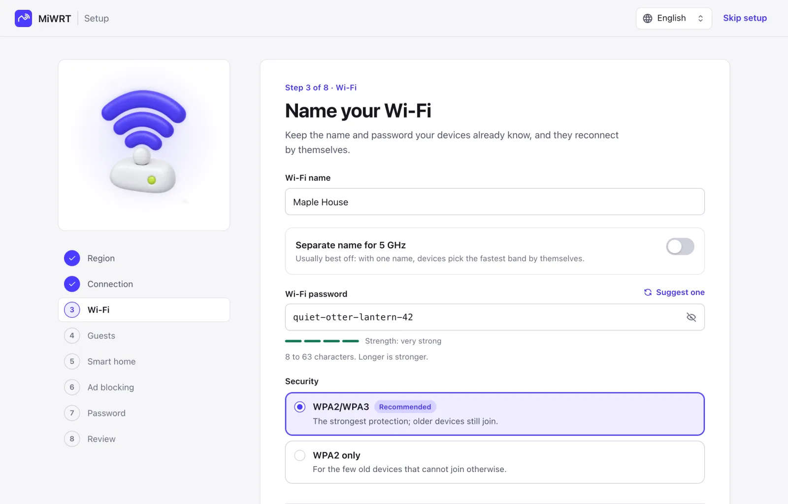
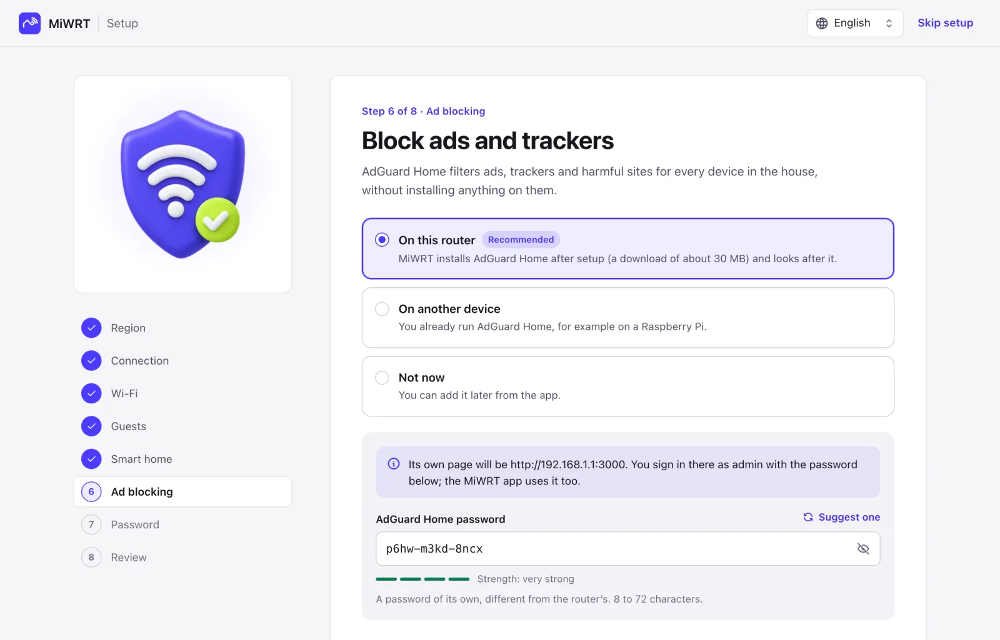
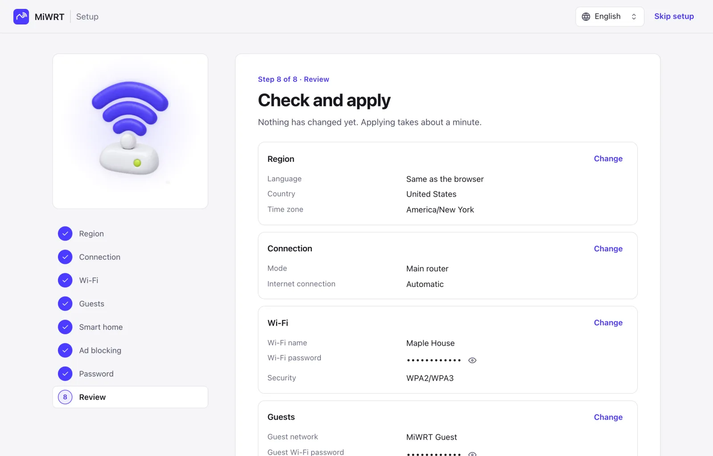
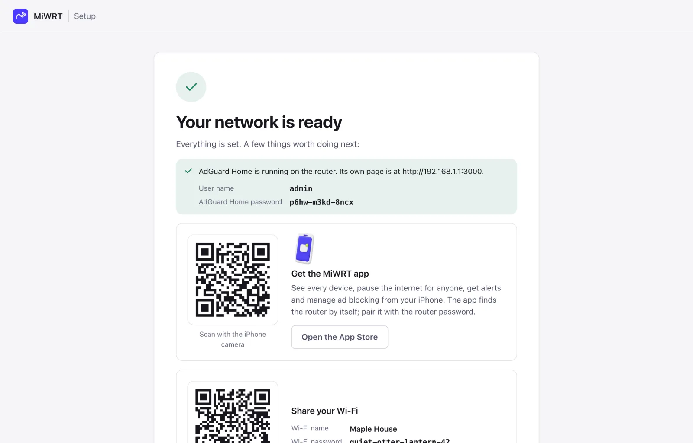
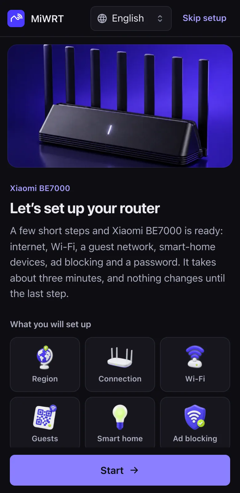
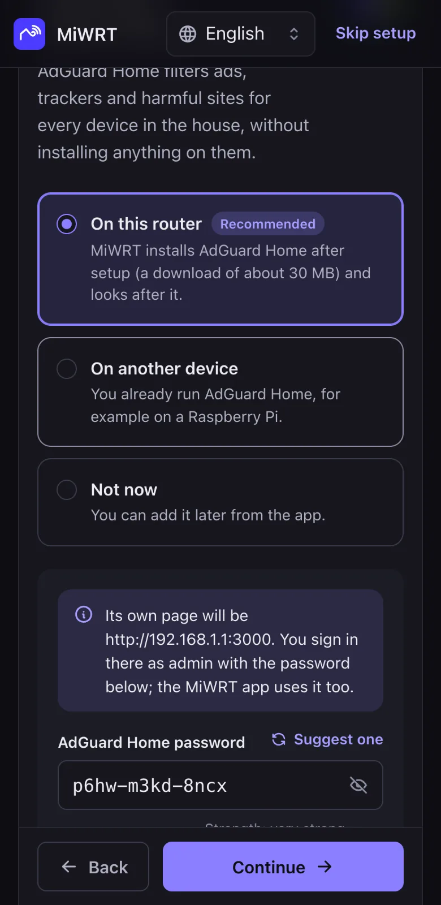
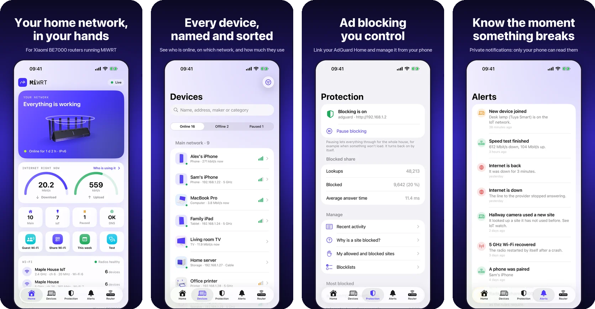

# MiWRT

OpenWrt firmware for the Xiaomi BE7000 (board RC06, Qualcomm IPQ9554), tuned to get the most out of the hardware, with a built-in service for the MiWRT phone app. An image for the Xiaomi Redmi Router AC2100 is in testing.

MiWRT stands on the work of the [OpenWrt](https://openwrt.org) project and of Timofey Maykov, whose Beam WRT firmware for the BE7000 is where MiWRT began. Everyone else whose work is in it is listed under [Credits](#credits-and-licence).

Current version: **2.3.1** (OpenWrt main d958caf, Linux 6.18.52). Images are in [Releases](https://github.com/iroham/MiWRT/releases), checksums in `sha256sums.txt` (`sha256sums-ac2100.txt` for the Redmi AC2100), what changed in [the release notes](docs/release-notes/v2.3.1.md).

  

## Contents

- [What MiWRT does](#what-miwrt-does)
- [First-time setup](#first-time-setup)
- [Wi-Fi tuning](#wi-fi-tuning)
- [Safe updates](#safe-updates)
- [The router's address](#the-routers-address)
- [The app service](#the-app-service)
- [Privacy](PRIVACY.md)
- [Installing, updating, going back](#installing-updating-going-back)
- [Redmi AC2100](#redmi-ac2100)
- [Building](#building)
- [Credits and licence](#credits-and-licence)

## What MiWRT does

**On the hardware**
- Boots natively from flash (no kexec). The factory firmware stays in the second slot as a way back, and updates switch slots with an automatic fallback.
- Wi-Fi 7 on 5 GHz with MLO (one network on both 5 GHz halves), the split two-radio 5 GHz mode, 2.5 Gbit/s ports, USB 3 and NFC.
- Hardware NAT through the packet processing engine (Network, Hardware offload).
- Boots on the newest BE7000 boards with an ESMT flash chip; the flash driver picks the error-correction strength per flash part, as the stock kernel does.
- Energy-Efficient Ethernet stays off on the four QCA8084 ports. With some ISP fibre boxes it causes receive errors and dropped links, and the SoC cannot use it anyway.
- The CPU voltage never goes below the stock level, and boot is about 8 seconds faster than a plain build (the LVM scan skips the raw flash partitions).

**Storage and recovery**
- System, Slots: switch to the factory firmware, or join the spare slot and the data partition into one storage for settings and packages (about 57 MB instead of 20). A byte-for-byte copy of the slot is saved first and can be written back.
- Factory reset works wherever the settings live (data partition, USB disk or the spare slot). It runs before the settings are mounted, resumes after a power loss and replaces only the settings. A USB disk gets up to 15 seconds to appear at that boot and is recognised by the UUID of its filesystem, so a `/dev/sda` that came back as `/dev/sdb` does not hold the reset up. A disk that was replaced or formatted since is never cleared.
- System, Storage says why a reset has not finished (the disk is missing, it is another disk, it does not mount, a write failed) and can cancel a reset that waits for a disk; a backup of the present settings is offered first. After a cancel the router stays on the slot's built-in storage with the settings it runs with, and the disk is not mounted or written.
- Moving the settings (to a USB disk, the joined spare slot or the data partition) is reported as done only after the entries were read back from the files. `uci` answers success for an `fstab` that does not exist and for a volume that is full, having written nothing; a move that went by that answer left the router on its built-in storage after the reboot. A missing `fstab` is now made before anything is formatted.
- A failing USB stick holding the settings does not send the router back to the factory firmware: after an unfinished boot the router starts on its built-in storage and stays reachable.
- Settings can be imported from the factory firmware, also when the router was the main unit of a Xiaomi mesh.
- `install-from-openwrt.sh` in every release archive moves a router to MiWRT from another OpenWrt build that kept the factory bootloader.

**Software**
- A web interface of its own (`luci-theme-miwrt`): the menu in a sidebar that folds into a drawer on a phone, light and dark modes that follow the system or stay as chosen, a search over every page (Ctrl+K or `/`), page actions that stay in view while you scroll, and the router itself on the sign-in page. Everything can be reached from the keyboard, controls are labelled for screen readers, and animations stop when the system asks for reduced motion. The stock theme can be chosen again on System, System, Language and Style.
- Updates: the router checks once a day and shows a notice; System, Build update downloads in the background with a progress counter, from this repository's GitHub Pages first and github.com second. Only this project's release files are accepted, and `sha256sums.txt` must carry the signature of the key in the router's own image. Before the download the free memory is compared with the size of the image plus 12 MB to spare, since the image waits in memory; up to 2.1.0 the updater asked for 120 MB whatever the image, which the Redmi AC2100 (128 MB in all) never has, so that router is updated from 2.1.0 by hand, once.
- A signed package feed built from the same tree as the image, kernel modules included, so `apk add` works for this exact kernel.
- Docker on request: the data directory is tested before it is used, containers reach the internet and their ports open from the LAN (`be7000-docker firewall`, `be7000-docker diag`).
- AmneziaWG and the GRE, L2TP, PPTP, IPIP, VXLAN, 6in4, 6rd, 6to4, DS-Lite, MAP, 464XLAT, relayd, bonding, SSTP, OpenConnect, vpnc, OpenFortiVPN and MBIM/NCM modem pages are in the feed. After a package adds a network protocol, LuCI offers the network restart it needs.
- **VPN (Xray)**: VPN, VPN (Xray) in the web interface and VPN in the app. The router connects to a VPN server and sends the traffic of all devices, the chosen ones or all but the chosen ones through it. Servers are added as `vless://` (REALITY included), `vmess://`, `trojan://`, `ss://` and `hysteria2://` links, or as a subscription the router fetches again once a day; each server can be tested, and the page shows the address websites see, the delay and the current rate. Options: the country's own websites (`.ir`, `.cn`, `.ru`) directly, and name lookups through the VPN. The guest and IoT networks never use it, and IPv6 is off for the devices that do, so nothing goes around it. A pause, a schedule or approval of new devices from the app holds for devices on the VPN too, and while the VPN restarts or cannot start, the devices that use it wait instead of going out directly. Xray installs from the MiWRT feed on the first use (`miwrt-xray-xz` on the BE7000, `miwrt-xray` on the Redmi AC2100) and can be removed again; a server that stops answering raises an alert.
- **Router link**: VPN, Router link. Two MiWRT routers join over VLESS with REALITY: the router abroad is the exit, the router at home uses its internet, and either side may open its home network to the other (the routers themselves stay closed). They meet at the router abroad when it has a public address (the router opens the port with a firewall rule) or at a server you rent, for which the page gives the Xray settings and a `docker run` line. Setting up is one code copied from the exit to the other router, plus a reply code when the home side shares its network; when the exit's code changes later, the home side takes the new one without setting the link up again.
- **Tailscale**: VPN, Tailscale in the web interface and Tailscale in the app. On the BE7000 a slim build of Tailscale 1.104.1 is in the image, switched off until you switch it on; on the Redmi AC2100 it is not in the image and the page installs it from the MiWRT feed, with compressed swap in memory, and removes it again. Sign-in with a link (open it on any device) or an auth key; the router can offer its home network (subnet router) and itself as an exit node, use another exit node, and reach Tailscale's servers through the VPN where they are blocked. The slim build leaves out what a router does not use (Tailscale SSH, Taildrop, Taildrive, serve and funnel, the web client): about 16 MB instead of 26 on arm64.
- Xray-core 26.11.9 is in the feed of both routers as `miwrt-xray`, with one MiWRT patch (`miwrt-feed/miwrt-xray/patches`): on a processor without AES instructions, such as the Redmi AC2100's, its Chrome-like TLS hellos offer ChaCha20 before AES-GCM, as Chrome itself does there. Go has no fast AES-GCM on such a processor, and with AES-GCM a tunnel on the AC2100 ran at about 8 Mbit/s; with ChaCha20 at 18 to 22 (one download; more with several). On the BE7000 install `miwrt-xray-xz`: the program is kept xz-compressed (about 7 MB instead of 30 on the settings volume) and unpacked into memory the first time it runs after a boot or an update. Either package only installs `/usr/bin/xray`; the VPN pages start it when a VPN or a router link is switched on.
- Changing the router's own address in LuCI (Network, Interfaces, LAN) no longer races a clock: the page confirms the new settings at the new address and opens itself there. See [The router's address](#the-routers-address).
- Restarting a service from inside it works. The service manager of this OpenWrt base ends every process a service started when the service stops, and an SSH session counts as started by the SSH service: `/etc/init.d/dropbear restart` typed over SSH used to end the session and the restart with it, half way, and SSH stayed down until the next boot (the same for `rpcd` restarted from System, Startup). The init script now steps out of the service first, with the session it was typed in, so the session stays and the service comes back.
- A "State (MiWRT)" LED trigger: any LED can show whether a process runs, an address answers or a command succeeds. The watcher behind it runs only while an LED uses the trigger.
- Shipped in the image: `curl` with HTTP/2, `sqm-scripts` (cake) with its page, `nlbwmon` (per-device traffic), `banip` (IP block lists), `umdns` (mDNS). `tcpdump-mini`, `iperf3` and `ethtool-full` are in the feed; the image has the plain `ethtool`.
- The build checks the image against the firmware slot: 40 MiB of flash hold 296 blocks of 124 KiB for the kernel, the system and the in-slot settings volume, and an image that would leave that volume less than 25 blocks (3 MiB) is refused (`patches/tree/025`). The system is compressed in 1 MiB blocks.
- Newer than the OpenWrt base where OpenWrt has fixed a security problem since: the web server (uhttpd), libubox, ubus, rpcd, curl 8.23.0, the certificate tool px5g, the CA bundle and the C library are OpenWrt's of early November 2026 (`patches/tree/019` to `024`, `patches/feeds/packages`).
- To install scripts the firmware reports itself as OpenWrt 25.12.6, so they do not refuse the version; "MiWRT 2.3.1" is in the description, the banner, Overview and the app.

## First-time setup

A router set up from scratch opens a setup assistant in the web interface instead of the usual status page. The sign-in page says to leave the password empty the first time. The assistant walks through:

1. **Language and region**: English, Russian or Chinese; the country (it decides which Wi-Fi channels and power are allowed) and the time zone, both guessed from the browser.
2. **How the router connects**: as the main router (address from the provider, a fixed address, or PPPoE with a user name and an optional VLAN), or as an access point behind another router (address from the main router, or a fixed one).
3. **Wi-Fi**: the network name and password (with a generator and a strength meter), one name for all bands or a separate 5 GHz name, and the security level.
4. **Wi-Fi channels**: the router listens for the networks around it for about ten seconds and suggests the least crowded channel on each band. You see how many networks sit on each channel and can take another one, or leave the channel as it is.
5. **Guest Wi-Fi**: a separate network for visitors, kept away from your own devices.
6. **Smart-home network**: a separate network for plugs, cameras and other IoT devices, with or without internet.
7. **Ad blocking**: AdGuard Home on this router (with a password of its own, suggested for you), one that already runs elsewhere on the network (checked before you go on), or none. A router that cannot run it says why.
8. **Router password**: for the web interface and SSH; it must differ from the Wi-Fi passwords.
9. **Review**: everything on one page, each part with a Change link.

How the channel is chosen (`/usr/share/ucode/miwrt/channels.uc`): on 2.4 GHz the choice is between 1, 6 and 11, the three that do not overlap. On 5 GHz it is between whole blocks at the width the radio already has (the width is never changed): blocks that need radar checks are not offered, nor blocks above channel 165 that many devices cannot see, nor a block the country allows far less power on; the block the radio is on stays on offer. Every network heard counts against a channel by how loud it is and how much of the channel it covers. The least loaded one is suggested; between channels that are about as good, 44 or 149 comes first on 5 GHz (Apple devices meet there for AirDrop and AirPlay and need not leave the router's channel), then the channel the radio is on. A channel is only offered when the router knows it is allowed in the country you chose: from the driver when that is the country it runs with, from the kernel's regulatory database on the Redmi AC2100, and on the BE7000, whose Wi-Fi firmware has rules of its own, only the block it is on until the country is set. The channel is checked once more when the settings are applied. Devices on the router's Wi-Fi pause for a second or two during the scan. Only counts per channel are kept, no network names.

Guest and smart-home networks are left out for an access point. Nothing changes until the last step: the settings are checked and applied in one go, the page follows the restart and says where to find the router afterwards (an access point gets a new address from the main router). A page reloaded meanwhile picks the progress up again. The last page has a QR code for the MiWRT app, one that joins the new Wi-Fi, and the AdGuard Home login if it was installed.

| | |
|---|---|
|  |  |
|  |  |

  
  &nbsp;&nbsp;
  

The names, addresses and passwords in these pictures are invented.

- Only fresh installs see it: no root password yet, and no Wi-Fi set up by MiWRT before (`/etc/.be7000_secure_defaults` on the BE7000, `/etc/.miwrt_wifi_defaults` on the AC2100). A router updated with its settings kept, or one that came from another OpenWrt build with a password, opens as usual. The state is `miwrt.setup.state` (`pending` or `done`).
- "Skip setup" leaves everything as it is and opens the usual interface. Once the assistant has finished or was skipped it does not run again by itself, and its page refuses to apply anything. To see it again: `uci set miwrt.setup.state=pending; uci set miwrt.setup.retry=1; uci commit miwrt`.
- Before applying, the settings are saved to `/etc/miwrt/setup-backup.tar.gz` (readable by root only). The new settings are staged and the firewall is checked first; if anything fails there, nothing is changed.
- An access point that gets no address from the main router within two minutes puts the old settings back, stays reachable at its old address and opens the assistant again. The check survives a power cut: it carries on at the next boot (`miwrt.setup.verify`).
- A smart-home network made here gets its firewall rules with it: addresses and DNS from the router, and the discovery and mDNS announcements the two relays repeat onto the main network.
- The page works on a phone and from the keyboard, follows the light or dark mode, and remembers what was entered if the browser reloads (the router, provider and AdGuard Home passwords excepted).

### AdGuard Home on the router

AdGuard Home can run on the router itself (from the setup assistant or the app's Protection tab), or anywhere else on the network, linked by its address and login. On the router (`/usr/libexec/miwrt-adguard`):

- It is installed from the package feed and answers DNS on port 53 for every network of the router. dnsmasq moves to port 54 and keeps handing out addresses and local names: AdGuard Home asks it for `*.lan` and for reverse lookups. Every DHCP pool tells its devices to use the router for DNS (option 6), so lookups reach AdGuard Home and not port 54.
- If AdGuard Home stops, the 30 s pass starts it again. If it is still not running a minute later, DNS goes back to dnsmasq so the network keeps resolving names, and an alert says so; remove it in the app and install it again to get ad blocking back. AdGuard Home itself falls back to dnsmasq when its own upstream servers do not answer.
- Its own page is at port 3000 of the router, user name `admin`, with a password of its own chosen in the assistant or the app (8 to 72 bytes, not the router password). The router keeps it for the app's Protection tab.
- It keeps one day of query log, to spare the flash.
- It needs 400 MB of memory, 32 MB free for settings and packages, and the router mode. The BE7000 has the memory, but a fresh install has about 19 MB free: join the spare slot under System, Slots (about 57 MB) or keep the settings on a USB disk, then install it from the app's Protection tab. The AC2100 has too little memory, so there an AdGuard Home can only be linked.
- Ad blocking off for a single device matches the device by its IPv4 address; a device that asks over IPv6 is still filtered.
- It stays through MiWRT updates like any package you added. Removing it from the app puts DNS back on dnsmasq. So does removing the package by hand under System, Software (an apk hook notices at once), and a router that boots without it does the same before dnsmasq starts, so the network keeps working.

## Wi-Fi tuning

### The radios run on Xiaomi's own board data

Board data tells a Wi-Fi chip about the board it sits on: the RF front end, antennas, power targets per channel. A plain OpenWrt build loads Qualcomm's generic reference-board data. MiWRT ships the files Xiaomi built for this router, taken from the stock firmware:

| Radio | Board data | Measured on a test unit |
|---|---|---|
| 5 GHz (QCN9274) | `bdwlan.b0002` (single radio) and `bdwlan.b1008` (split mode) | transmit power on channel 36 rises to the full UK/EU limit (19 → 23 dBm); downlink to a 2×2 Wi-Fi 6E laptop at 160 MHz ~800 → ~1,000 Mbit/s |
| 2.4 GHz (IPQ9554) | `bdwlan.b20`, with the generic file's regulatory table kept | loads cleanly, no measurable change; it is the data the board shipped with |

A boot service (`be7000-board-data`) puts the Xiaomi files back if a package reinstall ever restores the generic ones.

### Radar channels and 160 MHz work out of the box

OpenWrt only enables radar detection (DFS) when a country is set. Without one, channels 52-144 and every 160 MHz setting are silently unavailable. MiWRT sets a country on first boot for radios that have none (`GB` by default; change it under Network, Wireless). On a fresh install the service that brings Wi-Fi up (`be7000-wifi-defaults`) sets it, once the radios have started.

### 5 GHz starts on channel 44

On a new install the 5 GHz network is on channel 44, not on OpenWrt's 36. Both are in the same 80 MHz block (36 to 48), so width, power and range are the same. But 44 is one of the channels Apple devices meet on for AirDrop, AirPlay and Continuity: while one of those is active, a Mac or an iPhone leaves its network several times a second to listen there and misses what the router sends meanwhile. With the network itself on 44 it does not have to leave. A router that is already set up keeps its channel; set 44 under Network, Wireless (at 160 MHz on channels 36 to 64 it is the same block too). The two-radio 5 GHz mode still starts its lower radio on 36.

### 5 GHz: no daily group key renewal

hostapd renews the group (broadcast) key every 24 hours. On a test unit that renewal failed for every 5 GHz client, three days running at the same minute: all of them were disconnected at once ("group key handshake failed after 4 tries"), and one phone could not pass traffic again until the radio restarted. MiWRT sets `wpa_group_rekey 0` on 5 GHz networks on first boot, on a fresh install once the radios have started (a value set by hand is kept). A restart of the radio still makes a fresh key.

### Split-mode fix

Returning from the two-radio 5 GHz mode to one radio used to leave the upper radio's channel (149) behind; combined with 160 MHz that is a setting hostapd cannot start, and 5 GHz stayed down. The split script saves the single-radio channel and width and restores them.

### Driver recovery

The 5 GHz driver (ath12k) keeps its tables valid while the radio firmware restarts after a crash, so a firmware crash no longer takes the kernel with it. MLO networks start reliably: no scan while the network is created, a retry when one link fails, and a longer allowance before falling back to two radios. The app service restarts the router if a radio crashes and stays down.

## Safe updates

An update erases the running slot and then writes the new image into it. MiWRT checks that write for the `kernel` and `ubi_rootfs` volumes, tries it a second time if it fails, and logs every step to `/etc/miwrt/last-upgrade.log` on the settings volume, which survives the update. If both tries fail, the boot is pointed at the factory slot at once (unless that slot holds settings and packages, in which case the boot variables are left as they are and the log says so). Getting back from the factory firmware is described in `docs/instruction/3-rollback-and-problems-en.txt`.

Settings on the data partition, on the joined spare slot or on a USB disk outlive an update, and so does everything else that collected there: copies of image files left by a package upgrade or put there by hand, and apk's own record of what is installed. Left alone, those copies would hide the new image's files and apk would go on describing the old image. So the settings remember the build they last ran with (`BUILD` and `VERSION` from `/etc/miwrt-release`, kept in `/etc/.be7000_image`), and the first boot of any other build cleans up, whether or not the kernel changed. Settings that last ran with 2.1.0 or older carry no such note yet: there the first boot of a newer build cleans up when the settings hold apk's package database (a package was added or removed on that router at some time) and it describes another image; other routers get their note at that boot and are cleaned from the update after it on.

- Before the settings are mounted, every file among them that the new image also has is moved to `.be7000-replaced/` on the same volume; nothing is deleted, and a later update replaces that batch only when it has files of its own to put there. Settings stay where they are: `/etc/config`, the conffiles of packages, whatever `/etc/sysupgrade.conf` and `/lib/upgrade/keep.d` list, `/root`, passwords and keys, and the record of files you deleted. The data partition and the joined spare slot are cleaned at the start of the boot. A USB disk is not up that early, so it is cleaned on the first boot after the update, which runs without the disk, just before the router reboots onto it.
- The image's first-boot scripts (`/etc/uci-defaults`) run again, as they do after any OpenWrt sysupgrade, so a script that changed in the new image takes effect. They leave existing settings alone; the theme's script keeps a theme you chose and only steps in when that theme is no longer installed, and the app service's script switches the service on the first time only, so `/etc/init.d/miwrt disable` holds across updates.
- `be7000-romsync` then puts the image's package database in place of the old copy, keeps the packages you had added in the world file and installs them again from the feed once the internet is up and `be7000-feeds` has pointed the feed list at this image (it waits for that, five minutes at most). A library that carries its date in its name (`libubox20260721`) is left out when the image brings the same library under a newer date: no feed of the new image has the old name, and one such name in the world file makes apk refuse every `apk add`. Until the reinstall has run, a program from an added package that was built against such a library does not start. `be7000-feeds` takes feed lines of an earlier image out of `customfeeds.list` and adds the ones this image ships; a feed you added yourself stays. Only the world file kept in the settings says what was added, and it also names what the old image shipped, so a package that the old image had and the new one leaves out counts as added and comes back from the feed (from 2.2.0 to 2.3.0: `ethtool-full`, `iperf3` and `tcpdump-mini`). A router that never added or removed a package has no world file of its own and gets the new image's list as it is.
- Kernel modules from an earlier image are set aside only when the kernel itself changed, on a USB disk as well.

This clean-up first ran on a router at the update from 2.2.0 to 2.3.0, installed with `miwrt-update` on a BE7000 with its settings on the data partition. It moved the one old copy of an image file (`/etc/banner`) aside and ran 46 first-boot scripts again, and every configuration file came through unchanged. The packages of the point above came back from the feed. The joined spare slot and a USB disk have only been through `scripts/test-image-change.sh` so far.

The note is part of the settings, so joining or releasing the spare slot or moving to a USB disk takes it along and is not mistaken for a new firmware. A router that keeps its settings inside the firmware slot is not affected: an update wipes that space and restores the settings backup, as on any OpenWrt.

The system calls itself MiWRT in LuCI, the console banner and `/etc/openwrt_release`; the default hostname is `MiWRT`. Image file names stay `openwrt-qualcommbe-ipq95xx-xiaomi_be7000-…`, which the installer and the update page look up by name.

## The router's address

LuCI applies settings with a safety net: the router takes them and waits 90 seconds for the browser to confirm that it still gets through, and puts the old settings back otherwise. The browser sends that confirmation to the address the page was opened at. When the change is that very address, nothing answers there any more, so a correct change was rolled back unless you typed the new address into the browser in time. Where the address is stored as a list (OpenWrt's default, as on the Redmi AC2100), LuCI did not even warn about it.

`preload/lanmove.js`, loaded with every LuCI page, adds the missing half. Before the apply it asks the router which interface owns the address in the browser's address bar and what that interface's address will be. When it changes, the page says so and shows the new address as a link, and once the router has had the usual four seconds to switch, it sends the confirmation to the new address every two seconds. The first answer confirms the settings, and the same page is opened there. Nothing changes when the address stays, when the page was opened by name or over IPv6, or when anything in the class fails: LuCI then works as it always did.

- The device you configure from needs an address in the new network. In the same subnet that is immediate; in another subnet it has to renew its lease (replug the cable, or leave the Wi-Fi network and join it again) within the 90 seconds. The page says so.
- Over HTTPS with the router's own certificate a browser lets no request through to an address whose certificate it has not accepted. After ten seconds of immediate refusals the page therefore opens the new address itself, the browser asks about the certificate, and the sign-in page that follows sends the confirmation (LuCI does that on any page while a rollback is pending). Ten seconds, because a cable's link is down for a few seconds while the router re-reads its network settings, and requests fail at once during that, too.
- "Apply unchecked" has no rollback; the page is opened at the new address all the same.

## The app service

A small service on the router that a phone app talks to. Nothing else is needed on the network, and nothing goes through a cloud. It is written in ucode and shell, lives in `overlay-files`, and uses only what the image already has (uhttpd, rpcd, umdns, nlbwmon, banIP, Lua with nixio).

  

| File | Purpose |
|---|---|
| `/usr/share/ucode/miwrt/hub.uc` | state collection, device list, alerts, pausing, access keys |
| `/usr/share/ucode/miwrt/extras.uc` | Wi-Fi settings and schedule, guest Wi-Fi, firmware check and install, blocked threats, connection test, speed test, Wi-Fi check, speed shaping, IoT watch, summaries |
| `/usr/share/ucode/miwrt/power.uc` | remote power for laptops: sleep and restart over SSH with a restricted key, setup scripts for macOS and Windows |
| `/www/cgi-bin/miwrt`, `/usr/share/miwrt/api.uc` | the HTTPS API: the entry the web server starts, and the API itself |
| `/usr/sbin/miwrt-hubd`, `/usr/share/miwrt/tick.uc`, `/etc/init.d/miwrt` | one pass every 30 s, the network announcement, the two relays |
| `/etc/apk/commit_hooks.d/miwrt-compiled` | removes the compiled copies (below) after a package change |
| `/usr/sbin/miwrt-ctl` | `token <name>`, `tokens`, `revoke <name>`, `revoke-all`, `apns <key file> <key id> <team id>`, `apns-remove` |
| `/usr/sbin/miwrt-push` | encrypts alerts for each phone and sends them as notifications: straight to Apple when the router holds a push key, otherwise through the relay |
| `/usr/sbin/miwrt-discovery-relay` | repeats smart-home discovery broadcasts from an IoT network to the main one |
| `/usr/sbin/miwrt-mdns-reflector` | repeats mDNS (AirPlay, Chromecast, printers) between the main and the IoT network |
| `/usr/sbin/miwrt-upload` | the upload half of the speed test |
| `/usr/sbin/miwrt-wol` | Wake-on-LAN, as a broadcast and straight to the device's own address |
| `/usr/sbin/miwrt-tuya` | switches a Tuya Wi-Fi plug on the local network (protocol 3.3, 3.4, 3.5), without Tuya's cloud |
| `/usr/share/miwrt/oui.txt` | maker per MAC prefix |
| `/etc/miwrt/` | settings and state, kept across sysupgrade |

`miwrt-hubd` keeps compiled copies of the API and of the pass in `/tmp/miwrt` (memory, gone at every restart), because compiling 130 kB of ucode source on every request and every pass is what they spent most of their time on. On the Redmi AC2100 an API call took 0.6 s and takes 0.2 s now, most of the rest being the TLS handshake, and a pass took 0.65 s and takes 0.28 s. The entry uses a copy only when root made it and it is newer than every source; `miwrt-hubd` makes the copies again when a source or ucode itself changes. Without a copy the sources run, as before.

### Finding and pairing

- The router announces `_miwrt._tcp` (port 443) on the main network through umdns. The app finds it by itself.
- Pairing asks for the router's administrator password, the same one LuCI uses, and the password stays on the phone. The router keeps it as a salted hash (`/etc/shadow`); `POST /pair/start` gives the app the salt and a random value, the app computes the same hash and answers `POST /pair/finish` with an HMAC-SHA256 over both sides' random values and the fingerprint of the certificate it is talking to, and the router answers with its own. A device in between with another certificate gets a proof the router refuses; a device only posing as the router cannot produce the router's answer, and the app then saves nothing. On success the phone gets a random 256-bit access key; only the key's hash is stored. Wrong passwords are counted per address (5 in 10 minutes) and overall (40).
- The API is served over HTTPS with the router's own certificate. The app remembers that certificate at pairing and refuses any other afterwards.
- Every phone has its own key; keys can be listed and revoked from the app or with `miwrt-ctl`.
- The API is reachable from the main network only. Guest and IoT zones and the WAN side are rejected by the firewall.

### What it does

| Area | Details |
|---|---|
| Status | internet up or down with live rates, both radios, temperature, memory, uptime, firmware |
| Devices | online and offline, maker, network, band and signal, live rate, today and month totals, 30 days of daily history |
| Names, categories, icons | a name set in the app becomes a DHCP host entry (`miwrt_h_<mac>`), so LuCI and `name.lan` use it; optional fixed address |
| Pausing | per device: until resumed, or for a set time. One list feeds one firewall rule (`/etc/miwrt/blocked.nft`, placed ahead of the established-connection rule so running streams stop too) |
| Approve new devices | optional, off by default: a device the router has never seen gets no internet until it is allowed |
| People and rooms | groups of devices; pause a group; a person counts as home when one of their phones is on Wi-Fi |
| Schedules | internet off for chosen devices or groups at set times and days, including overnight |
| Wi-Fi | view networks, change name or password, switch a network off, hand out the details for a QR code; optional schedule that switches a network off at set times and days |
| Guest Wi-Fi | created on first use: own bridge, subnet and firewall zone, client isolation, optional auto-off |
| Alerts | radio crashed or recovered, internet down or back, DNS failing, new device, a device failing to join repeatedly, radar on 5 GHz, kernel errors, phone paired or unpaired |
| Notifications | off by default, per alert type, one switch in the app. Alert text is encrypted on the router with a key only the phone has; the relay and Apple carry it without being able to read it |
| Address service guard | if dnsmasq (addresses for devices, lookups sent to the router) stops, the next 30 s pass starts it again and raises an alert. The service's own reloads of dnsmasq are done one at a time by that pass |
| Wi-Fi recovery | if a Wi-Fi core crashes and stays down for about 90 s, the router restarts itself: not in the first 10 minutes after boot, at most three times a day |
| Ad blocker | installs AdGuard Home on the router, or links one that runs elsewhere on the network: on, off, pause, statistics, recent activity, allow or block a site, block lists, ad blocking off for a single device |
| IoT watch | with an ad blocker linked: the sites each device on a separate network (IoT, guest) looks up, grouped by main name. After a device's first day, a site it never used before raises an alert |
| Speed shaping | switch SQM (cake) on or off and set the download and upload limits |
| Checks | connection test, speed test from the router (download and upload), Wi-Fi channel check, blocked threats (banIP), protection overview, weekly summary, 48 hours of health samples |
| Laptop power | sleep, restart and wake for Mac and Windows laptops. The router holds one SSH key; each laptop accepts it only from the router and only for a fixed script (status, sleep, restart). A laptop is added with one setup command, valid once for 30 minutes, whose download is checked against a checksum. Wake uses Wake-on-LAN and needs the laptop asleep on its charger; a sleep or restart request wakes a sleeping laptop first. The setup also prepares the laptop for this on mains power: wake for network access and no deep power-off sleep on macOS; on Windows, wake on magic packet, no hibernation, and a closed lid no longer sleeps the PC |
| Smart plug power-on | for laptops whose Wi-Fi is off while they sleep: a Tuya plug on the charger, linked with its device ID and local key, is switched off for 45 seconds (a shorter cut is not noticed by a laptop that is off, because its charger holds its charge) to start a laptop that powers on when its charger is connected. Works from shutdown and from hibernation; with a plug linked, "sleep" on Windows means hibernate. The Windows setup can also make the PC hibernate wherever it used to sleep (idle time, lid on battery, sleep button, Start menu), for laptops that cannot be woken from sleep. The plug's power reading is taken every 5 minutes: 24 hours of readings and 60 days of energy per day are kept |
| Maintenance | settings backup download, lights on, off or off at night, restart, firmware version, update check and install (through `miwrt-update`) |
| Discovery relay | where an IoT network exists (`br-iot`), smart-home announcements (UDP 6666 and 6667) are repeated onto the main network so phone apps still find their devices |
| VPN | Xray client: servers from links or subscriptions, test, choose, on or off; all devices, the chosen ones or all but the chosen ones; the country's own sites directly; address, delay and rate; install or remove Xray |
| Router link | create (this router is the exit), join with a code, reply code, share the home network, use the other router's internet, remove; the relay server's settings |
| Tailscale | install or remove (Redmi AC2100), on or off, sign in or out, devices in the network, subnet routes, exit node (offer and use), through the VPN |
| Casting across networks | where an IoT network exists, mDNS is repeated both ways so phones on the main network find AirPlay and Chromecast devices, printers and speakers on the IoT side. Discovery only: the firewall still decides what may connect. An IoT network made by the setup assistant or the app has the input rule for UDP 5353 it needs; one made by hand needs it added |

### API

Base: `https://<router>/cgi-bin/miwrt`. `GET /health`, `POST /pair/start` and `POST /pair/finish` need no key; everything else needs `Authorization: Bearer <key>`.

| Method and path | Purpose |
|---|---|
| `GET /v1/status`, `/v1/devices`, `/v1/alerts`, `/v1/meta` | the main screens. `status.capabilities` says what this router has (`slots`, `split5g`, `usb`, `temperature`, `wifi_cores`, `sqm`, `banip`, `wan_speed_mbit`), so the app shows only those parts; `router.temperature` is `null` on a board without a sensor; `wifi.down` lists radios that are enabled but not running |
| `POST /v1/devices/<mac>` | `name`, `category`, `icon`, `blocked`, `pause_minutes`, `approve`, `fixed_ip`, `filtering` (`on` or `off`) |
| `POST /v1/devices/<mac>/wake` | Wake-on-LAN |
| `GET /v1/devices/<mac>/power`, `/power/plug`, `/power/usage`; `POST /v1/devices/<mac>/power` (`action`: `sleep`, `hibernate`, `restart`, `shutdown`, `poweron`, `wake`, `status`), `/power/setup` (`os`: `mac`, `windows`), `/power/plug` (`plug`, `device_id`, `local_key`, or `remove`), `/power/remove` | laptop power |
| `GET /power/s?c=<code>`, `POST /power/register` | used by the laptop's setup script, authorised by the one-time code, no access key |
| `GET`/`POST /v1/groups`, `/v1/schedules` | people and rooms, schedules |
| `POST /v1/settings` | `approve_new`, `watchdog`, `night`, `push` |
| `GET /v1/wifi`, `/v1/wifi/secret?id=`, `/v1/wifi/check`; `POST /v1/wifi/<id>` | Wi-Fi: `ssid`, `key`, `enabled`, `schedule` (`enabled`, `from`, `to`, `days`) |
| `GET`/`POST /v1/guest` | guest Wi-Fi |
| `GET /v1/protection`, `/v1/protection/lists`, `/v1/protection/log`, `/v1/protection/check`; `POST /v1/protection/connect`, `disconnect`, `install` (`password`, 8 to 72 bytes), `remove`, `pause`, `lists`, `rules` | ad blocker. `GET /v1/protection` has `where` (`router` or `network`) once linked; before that `can_install` and `install_blocker` (`unsupported`, `mode`, `memory`, `storage`); `install` is the last install or removal on the router (`state`, `step`, `error`, `age` in seconds by the router's clock) |
| `GET /v1/usage`, `/v1/week`, `/v1/history`, `/v1/threats`, `/v1/overview`, `/v1/diagnose`, `/v1/firmware`, `/v1/speedtests`, `/v1/iotwatch`; `POST /v1/speedtest`, `/v1/firmware/install` | insight, firmware |
| `GET`/`POST /v1/shaping` | speed shaping: `enabled`, `down_kbit`, `up_kbit` |
| `GET /v1/vpn` (`?check=1` checks the tunnel now); `POST /v1/vpn` (`enabled`, `server`, `who`, `devices`, `country`, `dns`), `/v1/vpn/install`, `/v1/vpn/remove`, `/v1/vpn/servers` (`action`: `add` with `text`, one link per line; `rename`, `delete` with `id`), `/v1/vpn/subscriptions` (`add` with `url`, `update`, `delete`), `/v1/vpn/test` | VPN (Xray). `engine.job` is the last install or removal, as for the ad blocker. `update` returns at once and fetches in the background while `subs_updating` is true |
| `GET /v1/link`, `/v1/link/relay`; `POST /v1/link` (`action`: `create`, `join`, `answer`, `set`, `remove`) | router link. `join` with the same link's new code updates it |
| `GET /v1/tailscale`; `POST /v1/tailscale` (`enabled`, `advertise_lan`, `advertise_exit`, `accept_routes`, `exit_node`, `via_vpn`), `/v1/tailscale/install`, `/remove`, `/login` (`auth_key`, optional), `/logout` | Tailscale |
| `GET /v1/phones`; `POST /v1/phones/revoke` | paired phones |
| `GET /v1/push` (`enabled`, `kinds`, `mode`, `registered`, `this_phone`); `POST /v1/push/register` (`token`, `env`, `key`), `/v1/push/test` | notifications |
| `POST /v1/router/backup` (with the administrator password); `POST /v1/router/leds`, `/v1/router/watchdog`, `/v1/router/reboot` | maintenance |

### Design notes

- The 30 s pass writes only to memory. Flash is written when something changes (a rename, a new device, an alert) and once a day for traffic totals.
- Every value that reaches a shell command is a constant or checked against a strict pattern; request bodies go through files.
- One writer at a time: the background pass and API requests share a file lock. Whoever holds it never calls rpcd (session login, device names, Wi-Fi status are read before taking it): rpcd answers one call at a time, and the web interface's VPN calls take the same lock inside rpcd. Those calls wait at most 15 seconds for it and then answer that the router is busy.
- If the pause-list file is missing or malformed the firewall ignores it and still starts.
- Notifications: Apple only delivers a push signed with the key of the app's publisher. That key is a secret and is not in this repository or in the images: anything shipped in firmware can be read out by anyone. So there are two ways, and the router picks by itself:
  - **Direct.** `miwrt-ctl apns AuthKey_XXXXXXXXXX.p8 <key id> <team id>` stores a key under `/etc/miwrt/apns/` (root only, kept across sysupgrade, never served by the API). The router then talks to Apple itself and nothing else is involved. This is for whoever publishes the app build the phone runs: the key must belong to that app.
  - **Relay.** A router without a key sends to a relay that holds it: the Cloudflare Worker in [miwrt-relay](miwrt-relay/README.md). The firmware's default relay is `DEFAULT_RELAY` in `hub.uc` (`https://miwrt-relay.iroham.cloud`, run by the app's publisher); `settings.push.relay` overrides it.
- Notification privacy: at registration the phone makes a random 64-byte key and gives it to the router over the pinned HTTPS connection. For each alert and each phone the router encrypts title and text (AES-256-CBC, then HMAC-SHA256 over IV and ciphertext). The notification that travels says only "Your router has an alert"; the app's notification extension checks the seal, decrypts, and shows the real text. A relay therefore sees notification addresses, the alert's kind, and ciphertext.
- Security measures:
  - Pairing counts wrong passwords per address (5 in 10 minutes) and overall (40), under the file lock; it is only taken over HTTPS and as JSON, which a web page cannot send from a browser on the network.
  - At most 600 devices are remembered. When the list is full the oldest device nobody named makes room. More than ten new devices in an hour raise one alert, not one each.
  - IoT watch remembers at most 300 sites per device and raises at most three alerts per device per pass.
  - Alerts read from the system log only count lines written by hostapd or the kernel, so a device cannot fake one through the name it gives when it asks for an address.
  - Laptop power: the laptop's SSH host key is stored with the laptop at setup and checked on every request, at whatever address the laptop has that day. The account name may not start with a dash. The macOS setup command downloads into a private folder, and when it is the one switching Remote Login on, Remote Login accepts keys only.
  - Notifications: each alert carries its time, id and kind inside the encrypted text; the app shows only the generic line for one stamped more than two hours away from now. A relay must be `https://`; plain `http://` is accepted only for a relay at a private address.
  - The app service's files and `/etc/miwrt` are readable by root only.
  - Firmware updates: the build signs `sha256sums.txt` with the key every image carries (`sha256sums.txt.sig`). The updater takes files only from this repository's releases and refuses a release whose signature does not match the key in its own ROM.
  - The relay Worker counts every notification against the sending home (an IPv6 home counts as one /64), sends nothing when its limiter is unavailable, and checks the size before reading a request.
  - A settings backup (`POST /v1/router/backup`) needs the administrator password as well as the access key: it holds the Wi-Fi passwords and the router's own keys.
  - The relay keeps a fingerprint per phone and accepts that phone's notifications only with the random value the phone gave its router (`sender` at registration, `auth` towards the relay).
  - Fresh installs: the Wi-Fi password is the unit's serial number from its label, without the slash, instead of one password shared by every router. Only a unit whose serial cannot be read falls back to a shared one (`be7000openwrt`).
- Android: the same split would apply to Firebase Cloud Messaging (a service-account key instead of the Apple key). There is no Android app yet, so the router has no FCM sender yet.

## Installing, updating, going back

The procedures come with every release archive:

- [Install from stock](docs/instruction/1-install-en.txt) (needs root SSH on the stock firmware)
- [Update](docs/instruction/2-update-en.txt): System, Build update in LuCI, or `miwrt-update apply`, or sysupgrade with the `…-sysupgrade.bin` from a release. Settings are kept.
- [Back to stock, and troubleshooting](docs/instruction/3-rollback-and-problems-en.txt): System, Slots in LuCI switches to the stock firmware in the other slot.

Never write to the bootloader partitions `0:APPSBL` and `0:APPSBL_1`.

## Redmi AC2100

A MiWRT image for the Xiaomi Redmi Router AC2100 is in testing: the `ac2100 image` workflow builds it with the official OpenWrt ImageBuilder from `overlay-ac2100/` and the shared MiWRT files; nothing in the BE7000 build changes for it. It carries the same version as the BE7000 image and is released with it: a tag `v*` starts both builds, and both put their files into the release of that tag. The AC2100 files are the ones with `ac2100` in the name: the `kernel1`, `rootfs0` and `sysupgrade` images, `miwrt-ac2100-v<version>.zip` with the texts, and `sha256sums-ac2100.txt` with its signature. The install, update and recovery texts are in [docs/instruction/ac2100](docs/instruction/ac2100/); they say what to verify first.

A router on OpenWrt 21.02 or newer moves to MiWRT with the `sysupgrade` image like to any official OpenWrt release: the image carries the same metadata (`xiaomi,redmi-router-ac2100`, compat version 1.1), so OpenWrt takes it with the settings kept. A router that was set up there (a root password, or a Wi-Fi network with a password or switched on) keeps its Wi-Fi, its country and its choice of flow offloading; MiWRT adds its own pages, theme and app service. What updates keep beyond OpenWrt's defaults is listed in the image (`/lib/upgrade/keep.d/miwrt-ac2100`), not in `/etc/sysupgrade.conf`, which settings from another OpenWrt can replace. OpenWrt 19.07 (swconfig) needs a new start without settings, as for an official image.

Its own packages come from OpenWrt's feeds, and MiWRT's packages for it (Xray and Tailscale, both installed only when asked for) from a small signed feed on this repository's GitHub Pages, `feed/ac2100/<OpenWrt release>/mipsel_24kc/miwrt`, which the image lists in `/etc/apk/repositories.d/miwrt.list`. The workflow builds that feed with the official OpenWrt SDK (`scripts/ac2100/build-feed.sh`) and publishes it with every release, or on a manual run on `main` with `publish_feed` ticked; other runs keep it in the artifact next to the image.

Where the testing stands: the project has installed 2.1.0 once, from the stock firmware (2.0.23) on one router, with the steps of the install text. It booted on the first try and again after a reboot, both radios came up and heard neighbouring networks, the MAC addresses matched the Factory partition, and the web interface and the app service answered. Changing the LAN address in LuCI was run on it in Chrome, there and back, with and without the new class. With test builds of the source after 2.1.0 the same router has since run: internet on the WAN port behind another router (IPv4 and IPv6, nothing answering from the WAN side), the updater's check against GitHub, the package feeds (a package installed and removed), a Wi-Fi client on each band (5 GHz: 200 to 300 Mbit/s down, 300 to 380 up; 2.4 GHz: about 45 down, 27 up, with a two-stream laptop), an update that keeps the settings, a fresh install and the restore of a settings backup. The updater's download was run with the check as it is from 2.2.0: the 2.1.0 image arrived and its signature and checksum were verified. Not tested yet: applying the setup assistant's settings from a browser (its pages were walked up to the review, the channel step with a change of country, a scan that fails and a second scan), the install step of the updater, a wired client's speed, and TFTP recovery; no recovery path has been exercised. A router on 2.1.0 is updated by hand, once: its updater refuses the download for lack of memory (see the update text). Back up the flash before installing, as the install text describes. The default Wi-Fi password is the serial number from the label without its slash. The same router was later updated to 2.2.0 by hand with the steps of the update text, and the VPN, the router link and Tailscale of 2.3.0 were run on it against a server abroad before the release (installed from the feed, then removed again). The move from OpenWrt was run on it too: official OpenWrt 25.12.6 set up as an owner would have it (a root password, Wi-Fi with a password, one radio without a country, flow offloading not set, an edited `sysupgrade.conf`), then the MiWRT image of main with the settings kept, then one more MiWRT update. The Wi-Fi, network, DHCP and SSH settings and the root password came through unchanged, as did the owner's own kept file; MiWRT added only its firewall hook, theme and host name.

5 GHz on this router: OpenWrt's driver (mt76) has no transmit beamforming for the MT7615, which the stock firmware's driver has, so the four antennas help when the router receives and not when it sends two streams. On the test router a two-stream laptop's frames arrived at MCS 9 while the router's frames to it got through at MCS 6 and 7; MCS 8 failed for a third to two thirds of them and MCS 9 for nearly all, with 36 dB of signal to spare. Download to that laptop was therefore slower than upload: 280 to 390 Mbit/s against 300 to 600, both changing with the hour. From 2.2.0 the image carries the two modules of this driver built with a patch by Lutfil Hadi that adds explicit beamforming (`scripts/ac2100/mt76-patches`); everything else is OpenWrt's packages as before. It is off until you switch it on, with two commands from the problems text, because the patch is young: one author, and so far his router and the project's, one client each. Switched on at the project's router, with the original and the patched driver loaded in turn, twice: download 257 to 404 Mbit/s (median 332) with the original and 472 to 606 (median 526) with beamforming, repeated frames down from 35 in 100 to 5, MCS 9 getting through about 9 times in 10; upload unchanged. The image as built here was then installed on that router: beamforming is off after the install, on after the two commands and after a further update, and off again once the file is deleted. Two more things. Forbidding the failing rates instead was tried and is not in the image: 7 runs of 10 were faster with it and 2 collapsed to 107 and 183 Mbit/s. And a new install puts 5 GHz on channel 44 instead of 36, in the same 80 MHz block. While AirDrop, AirPlay or Continuity are active, Apple devices leave their network several times a second to listen on 44, and leave less than half as often when the network is there; download to a Mac in that state went from about 235 to 305 Mbit/s. With those services idle the channel made no measurable difference.

## Building

GitHub Actions builds everything: a tag `v*` produces the images for both routers, the signed package feed on this repository's GitHub Pages and one release whose text is `docs/release-notes/<tag>.md`. The Redmi AC2100 image takes about ten minutes and the BE7000 one well over an hour, so the release appears with the AC2100 files first and the BE7000 files join it when their build ends. The workflow needs one secret, `APK_SIGNING_KEY` (an EC P-256 private key in PEM); images trust its public key. Pushing to the branch does not build the BE7000 image; only a version tag does. Run by hand, the workflow builds the packages and publishes the feed but no release; with `warm` ticked it builds only the image and publishes nothing, plus the feed packages named in `test_packages`, which it keeps as a workflow artifact to try on a router. Before the feed is published it checks that every feed the image's `customfeeds.list` names was built.

To build by hand, follow `.github/workflows/build.yml`: the OpenWrt tree at the commit in `patches/port/BASE`, the BE7000 port series from `patches/port` applied with `git am`, the kernel patches from `patches` copied to `target/linux/qualcommbe/patches-6.18`, the ath12k and mac80211 patches to their package, `patches/tree` applied on top, `patches/feeds/<feed>` applied to that feed's checkout, `overlay-files` as `files/`, `luci-theme-miwrt` in `package/`, then `config.buildinfo` as `.config`. A few LuCI files in `overlay-files` replace LuCI's own; `patches/luci` holds what changed in each against the pinned LuCI, to be applied again when the pin moves.

Checks that run on a desktop shell: `scripts/test-factory-reset.sh`, `scripts/test-factory-reset-writers.sh` and `scripts/test-slot-storage-preinit.sh` exercise the boot and reset scripts; `scripts/test-slot-switch.sh` checks what the "make this slot the main one" button writes to the bootloader and when it refuses; `scripts/test-image-change.sh` builds a made-up image and settings volume and checks what an update moves, keeps and reinstalls; `node scripts/test-lanmove.js` runs the class that follows the router to a new address against a stand-in for LuCI and a clock of its own; `scripts/test-channels.sh` checks which Wi-Fi channels the setup assistant offers and which one it suggests, from made-up driver lists, country rules and scans (it needs `ucode`, so it runs on a router or in an OpenWrt root filesystem and says so elsewhere; the head of the script has the commands); `scripts/i18n-check.sh` checks that every interface string has its English and Chinese translation and that the `.lmo` files match the `.po` files.

`scripts/test-storage-fstab.sh` needs the real `uci`, because what it checks is how `uci` answers when it wrote nothing, so it runs on a router, in `/tmp`, with stand-ins for `mount`, `block`, `mkfs.ext4` and `reboot`; on a machine without `uci` it says so and passes. The head of the script has the command that copies it to a router and runs it. It touches neither the router's settings nor its storage. `scripts/test-service-self-restart.sh` also runs on a router, because it needs a real service manager and cgroups: it starts a service of its own (one `sleep`), stops and restarts it from a shell placed inside that service, and checks that the shell lives on and the service comes back. Its first run uses the init framework with the guard taken out and has to fail. On a router whose service manager does not end a stopped service's processes by itself (OpenWrt 25.12, the Redmi AC2100), the test's own service does that, as the newer one does; no service of the router is touched.

## Credits and licence

MiWRT is made from the work of others:

- **[OpenWrt](https://openwrt.org)**: the operating system, LuCI and the packages.
- **Timofey Maykov** (Beam WRT): the BE7000 firmware MiWRT grew out of, with native boot, the two-slot install, the Ethernet and flash driver fixes, hardware NAT and the Slots page.
- **[kravasuper](https://github.com/kravasuper/openwrt)**: the OpenWrt port to the BE7000 on Linux 6.18 (`patches/port`).
- **dima424658** ([openwrt#20604](https://github.com/openwrt/openwrt/pull/20604)), the first BE7000 support for OpenWrt; **Kenneth Kasilag** ([openwrt#24033](https://github.com/openwrt/openwrt/pull/24033)), the UNIPHY, USXGMII and PPE offload series for IPQ9574; the **Alta Labs Route10** port ([openwrt#25322](https://github.com/openwrt/openwrt/pull/25322)).
- **Lutfil Hadi** ([mt7615-txbf](https://github.com/lutfilhadimohdafez/mt7615-txbf)): transmit beamforming for the MT7615 in mt76, the patch the Redmi AC2100 image builds its 5 GHz driver with (`scripts/ac2100/mt76-patches`).
- **Linux** and its ath12k Wi-Fi driver; **Xiaomi**, whose board data files ship in the image as the stock firmware carries them.
- **[Slava Shchipunov](https://github.com/Slava-Shchipunov/awg-openwrt)**: the AmneziaWG packages for OpenWrt that `awg-feed` and `awg-proto-feed` are built on (awg, the network script and the LuCI protocol page).
- Third-party packages in the feed, built from their authors' recipes and pinned in `feeds-extra.conf`: AmneziaWG, zapret, zapret2, ByeDPI and NetShift.
- **[Project X](https://github.com/XTLS/Xray-core)**: Xray-core, which `miwrt-xray` builds from its release source; the recipe follows OpenWrt's `xray-core` package by Tianling Shen.
- **[Tailscale](https://github.com/tailscale/tailscale)** (BSD-3-Clause): the Tailscale client, which `miwrt-tailscale` builds from its release source with fewer features; the recipe follows OpenWrt's `tailscale` package.
- The people who tested BE7000 boards and reported bugs, listed on System, Credits in the web interface.

Kernel patches in `patches/` are GPL-2.0-only, like the Linux kernel, and keep their authors' names; the mt76 patch in `scripts/ac2100/mt76-patches` is under mt76's licence, BSD-3-Clause-Clear. OpenWrt and the third-party packages keep their own licences. The maker list (`oui.txt`) is derived from the IEEE's public registry.
